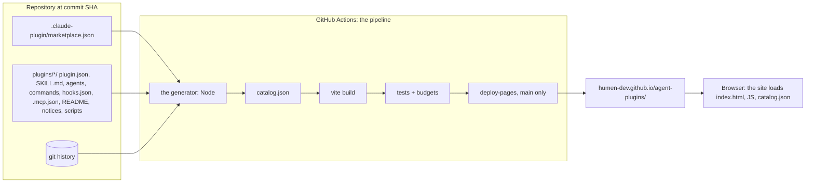
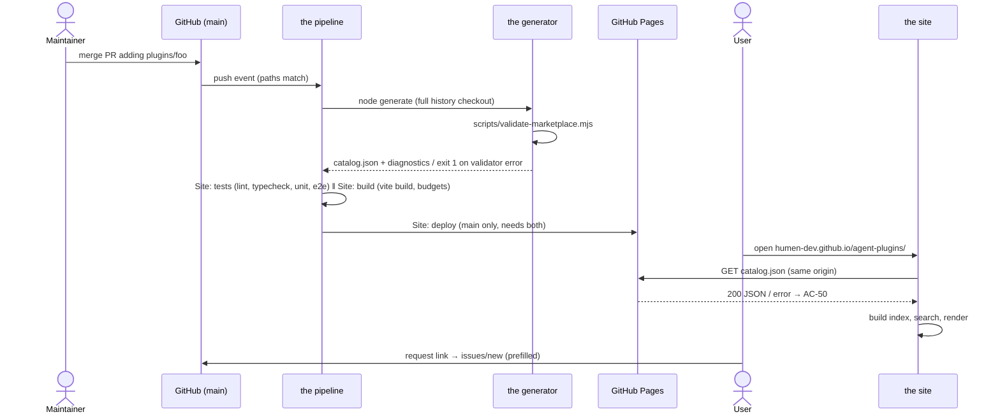

# Spec: Marketplace catalog site

Spec ID: SPEC-01
Status: draft
Created: 2026-11-23
Approved: none
Modules: root
System names: the generator (Node script that builds the catalog from the repo) · the site (static browser app on GitHub Pages) · the pipeline (GitHub Actions workflow that builds and deploys)
Supersedes: none
Superseded by: none

## Problem and user

The `humen-dev` marketplace (`.claude-plugin/marketplace.json`) lists 8 plugins
with 11 skills, 6 agents and 2 hooks. The only way to find what exists today is
to read `README.md:52` (a plugin table) or browse `plugins/*/` on GitHub. Nobody
can ask "is there a skill for safe migrations?" and get an answer. Nobody can see
what a plugin executes before installing it, short of reading `hooks/hooks.json`
and the scripts. Nobody can get the install commands for a set of plugins in
one step.

Users:

- **Plugin user**: a developer who wants a skill or agent for a task, wants to
  know what it runs on their machine, and wants to install it.
- **Team lead**: wants one snippet that enables a set of plugins for a whole
  project.
- **Contributor or maintainer**: wants a new or changed plugin to appear on the
  site with no manual step, and wants a broken plugin to fail CI instead of
  breaking the site.

## Goals / Non-goals

**Goals**

| ID | Goal | Success measure |
|---|---|---|
| G-1 | Find any plugin or artifact by a free-text task description | the golden queries in AC-14 return the expected item in the top 3 |
| G-2 | Know what a plugin runs before installing it | every hook, MCP server, script and agent tool list in the repo appears on its plugin page, copied from files (AC-27..AC-33) |
| G-3 | Install one plugin or a set of plugins in one copy | copy buttons produce commands and a settings snippet that `claude` accepts (AC-36..AC-41, manual check M-3) |
| G-4 | Zero manual steps to publish | a merged PR that adds a plugin is live on the site with no other action (AC-52) |
| G-5 | Only real data in production | the production catalog has exactly the plugins in `marketplace.json`, and no fixture data (AC-6, AC-7) |

**Non-goals**

- Accounts, ratings, comments, analytics, server-side search or any backend.
- Installing plugins from the browser. The site only shows commands to copy.
- Showing plugins from other marketplaces.
- Stats page, plugin scaffolding, and SKILL.md validation in the browser
  (deferred, P2).
- Deep links to headings inside a page.
- Localisation into other languages. All UI strings sit in one file so it is
  possible later (AC-63).
- A custom domain.
- SEO-oriented per-route static HTML. Hash routes are accepted.

## User stories

- **US-1** (search, P0): As a plugin user, I want to type a task in plain words
  and see matching plugins, skills, agents, commands, hooks and MCP servers, so
  that I find the right tool without knowing its name.
- **US-2** (filters, P0): As a plugin user, I want to narrow results by kind and
  category, so that I see only skills, or only backend items.
- **US-3** (plugin page, P0): As a plugin user, I want one page per plugin with
  what it adds, version, author, license, notices, last update and recent
  changes, so that I can judge it.
- **US-4** (artifact page, P0): As a plugin user, I want to read a skill's or
  agent's full instructions and settings, so that I know what it will make
  Claude do.
- **US-5** (what it runs, P0): As a plugin user, I want to see every hook
  command, MCP server, script and agent tool permission a plugin ships, so that
  I know what runs on my machine before I install.
- **US-6** (install, P0): As a plugin user, I want a copy-ready install command
  on every card and page, so that installing takes one paste.
- **US-7** (install set, P1): As a team lead, I want to pick several plugins
  and copy either CLI commands or a project `.claude/settings.json` snippet,
  with dependencies included, so that my team gets the same set.
- **US-8** (what's new, P1): As a plugin user, I want a feed of added plugins,
  version bumps and changes from git history, so that I notice updates.
- **US-9** (request, P1): As a plugin user who found nothing, I want a
  prefilled GitHub issue link, so that I can ask for the missing skill in one
  click.
- **US-10** (auto publish, P0): As a maintainer, I want every push to `main`
  that touches plugins or manifests to rebuild and redeploy the site, so that
  the catalog is never stale.
- **US-11** (theme, P0): As any user, I want a dark theme by default and a
  light theme toggle that is remembered, so that the site is comfortable to read.

## Architecture



- **The generator** runs only at build time, in the pipeline (and locally for
  development). Its first step runs `scripts/validate-marketplace.mjs`, and it
  fails only on that validator's errors. It then reads the checkout and git
  history and writes one `catalog.json`. Every other problem it finds becomes
  a warning in `diagnostics`. It is the only component that reads the
  repository.
- **The site** is a Vite + React + TypeScript single-page app with hash
  routing. It fetches `catalog.json` from its own origin. It builds the search
  index in memory (MiniSearch) and renders every page from that one file. It
  never calls the GitHub API or reads repository files.
- **The pipeline** is one new workflow, "Site", with three jobs that show as
  separate checks: "Site: tests", "Site: build" and "Site: deploy" (see
  CI/CD). On a pull request only tests and build run. On a push to `main`,
  deploy also runs.
- **Code location**: everything new sits under `site/` (app, generator, tests,
  fixtures, its own `package.json` and lockfile), plus the new workflow and an
  issue form. Plugins, manifests and the existing validators are not changed.
- **Routes** (hash):

  | Route | Page |
  |---|---|
  | `#/` with optional `?q=&kind=&cat=` | search (home) |
  | `#/plugins/<plugin>` | plugin page |
  | `#/plugins/<plugin>/<kind>/<name>` | artifact page |
  | `#/install` with optional `?p=a,b` | install-set builder |
  | `#/new` | what's new |
  | anything else | not-found state |

## Catalog data model

The generator emits this shape. The site imports the same type definitions.

```ts
type Kind = 'plugin' | 'skill' | 'agent' | 'command' | 'hook' | 'mcp';
type ArtifactKind = Exclude<Kind, 'plugin'>;

/** Raw Markdown plus its repo path. The site renders it safely (UT-1..UT-3). */
interface Markdown { path: string; source: string; }

interface Person { name: string; url: string | null; } // e-mail is never copied

interface Catalog {
  schemaVersion: 1;
  marketplace: {
    name: string;              // "humen-dev"
    description: string;
    version: string | null;    // metadata.version
    owner: string;             // owner.name
    repo: string;              // "humen-dev/agent-plugins", from the pipeline env, or a flag locally
    repoUrl: string;           // https://github.com/<repo>
    addCommand: string;        // "claude plugin marketplace add <repo>"
  };
  build: { commit: string; commitDate: string }; // HEAD sha and its committer date (ISO 8601)
  categories: string[];        // distinct marketplace categories, sorted
  kinds: Kind[];               // kinds with at least one item, in Kind order
  plugins: Plugin[];           // sorted by name
  artifacts: Artifact[];       // sorted by id
  changes: Change[];           // newest first, at most 100
  diagnostics: Diagnostic[];   // warnings only, sorted by path then message
}

/** A source problem that is not a validator error. It never fails the build (AC-65). */
interface Diagnostic { level: 'warning'; path: string; message: string; }

interface Plugin {
  id: string;                  // = name
  name: string;
  description: string;         // marketplace entry; else plugin.json
  category: string | null;     // marketplace entry
  tags: string[];              // marketplace tags ∪ plugin.json keywords; lower-case, unique, sorted
  version: string | null;      // plugin.json
  author: Person | null;
  license: string | null;
  homepage: string | null;     // only http(s), else null
  repository: string | null;   // only http(s), else null
  dependencies: { name: string; version: string | null; inCatalog: boolean }[];
  installCommand: string;      // "claude plugin install <name>@<marketplace.name>"
  path: string;                // "plugins/<name>"
  sourceUrl: string;           // <repoUrl>/tree/<build.commit>/<path>
  summary: string;             // plain text, ≤ 300 chars (rule X-9)
  readme: Markdown | null;
  thirdPartyNotices: Markdown | null;
  updated: string | null;      // committer date of the last non-merge commit touching path
  artifactIds: string[];       // sorted
  runs: RunProfile;
  recentChanges: Change[];     // ≤ 10, newest first
}

interface ArtifactBase {
  id: string;                  // `${kind}:${plugin}/${name}`
  kind: ArtifactKind;
  name: string;
  plugin: string;
  description: string;         // "" when the source has none (never invented)
  path: string;                // repo-relative file that defines it
  sourceUrl: string;           // <repoUrl>/blob/<build.commit>/<path>
  invokeAs: string | null;     // rule X-6
  headings: string[];          // H1–H3 text of body and files, in order
  body: Markdown | null;       // file content without frontmatter
  files: { path: string; title: string; body: Markdown }[]; // supporting .md, sorted by path
  frontmatter: Record<string, string | number | boolean | string[]>; // every key, verbatim
}

interface Skill extends ArtifactBase {
  kind: 'skill';
  argumentHint: string | null;
  userInvokedOnly: boolean;    // disable-model-invocation: true
  allowedTools: string[] | null;
  model: string | null;
}
interface Agent extends ArtifactBase {
  kind: 'agent';
  model: string | null;
  tools: string[] | null;      // null = not declared (inherits the session's tools)
  disallowedTools: string[];
  preloadedSkills: string[];   // frontmatter `skills`, as written ("plugin:skill")
  maxTurns: number | null;
}
interface Command extends ArtifactBase {
  kind: 'command';
  argumentHint: string | null;
  allowedTools: string[] | null;
  model: string | null;
}
interface Hook extends ArtifactBase {
  kind: 'hook';
  event: string;               // e.g. "PreToolUse"
  matcher: string | null;
  type: string;                // "command" | "prompt" | … verbatim
  command: string | null;      // verbatim, ${CLAUDE_PLUGIN_ROOT} kept as written
  timeout: number | null;      // seconds
  scripts: string[];           // repo paths of plugin files the command references
  definedIn: string;           // "plugins/x/hooks/hooks.json" or "plugins/x/.claude-plugin/plugin.json"
}
interface McpServer extends ArtifactBase {
  kind: 'mcp';
  transport: string;           // "stdio" when command is set and no type is given; else type verbatim
  command: string | null;
  args: string[];
  url: string | null;
  envVars: string[];           // names of env keys only, never values
  definedIn: string;
}
type Artifact = Skill | Agent | Command | Hook | McpServer;

interface RunProfile {
  runsCode: boolean;           // hooks.length + mcpServers.length + scripts.length > 0
  hooks: string[];             // artifact ids
  mcpServers: string[];        // artifact ids
  scripts: { path: string; sourceUrl: string; referencedBy: string[] }[]; // referencedBy = hook ids
  agentTools: { agent: string; model: string | null; tools: string[] | null; disallowedTools: string[] }[];
  whatItRuns: { heading: string; text: Markdown }[]; // README "## What it runs" → each "### heading"
}

interface Change {
  commit: string;              // full sha
  date: string;                // committer date ISO 8601
  subject: string;             // first line of the commit message, verbatim
  plugin: string | null;
  type: 'added' | 'version' | 'change';
  version: { from: string | null; to: string } | null;
  url: string;                 // <repoUrl>/commit/<sha>
}
```

## Extraction rules

The generator applies these rules. Each rule is covered by a fixture test (AC-1..AC-12).

| ID | Source | Rule |
|---|---|---|
| X-1 | `.claude-plugin/marketplace.json` | One `Plugin` per `plugins[]` entry, in no other case. `name`, `description`, `category` and `tags` come from the entry. `source` must be a relative path inside the repo. |
| X-2 | `<source>/.claude-plugin/plugin.json` | `version`, `author{name,url}`, `license`, `homepage`, `repository`, `keywords`, `dependencies` (string or `{name,version}`). `description` is used only when the entry has none. |
| X-3 | `skills/<dir>/SKILL.md` | One `Skill`. `name` comes from frontmatter, else `<dir>`. `description` comes from frontmatter (folded YAML is joined into one line). Every other `.md` under `skills/<dir>/` becomes `files[]`, with `title` taken from its first H1, else the file name. |
| X-4 | `agents/*.md` | One `Agent`. `tools` and `disallowedTools` accept a YAML list or a comma-separated string, trimmed. A missing `tools` key gives `null`. `skills` gives `preloadedSkills`. |
| X-5 | `commands/**/*.md` | One `Command`. `name` is the path under `commands/` without `.md`, with `/` replaced by `:` (Q-1). `description` comes from frontmatter, else the first non-empty body line. |
| X-6 | invokeAs | skill: `/<plugin>:<name>`. command: `/<plugin>:<name>`. agent: `<plugin>:<name>`. hook and mcp: `null`. |
| X-7 | `hooks/hooks.json` and `plugin.json` `hooks` (object, or path to a JSON file) | One `Hook` per inner hook object. `name` is the basename without extension of the first plugin file referenced in `command`. Else it is `<event>-<n>`, where `n` is the 1-based position. Duplicates get `-2`, `-3`, and so on. `scripts` lists files under the plugin folder whose relative path occurs in `command` (`${CLAUDE_PLUGIN_ROOT}/` is stripped for matching). `description` is the first paragraph under the README `### <name>` heading in `## What it runs`, else the `hooks.json` top-level `description`, else `""`. |
| X-8 | `.mcp.json` and `plugin.json` `mcpServers` | One `McpServer` per key. `envVars` holds the `env` keys only. `description` is the first paragraph under the README `### <key>`, else `""`. |
| X-9 | `README.md` | `readme` is the full file. `summary` is the first paragraph after the H1 that is not a table, list, code block or HTML. Markdown is stripped to plain text and cut at a word boundary to ≤ 300 chars with `…`. With no such paragraph, `summary` is the plugin `description`. |
| X-10 | `README.md` `## What it runs` | Each `### heading` and its text become `whatItRuns[]`, verbatim. A missing section gives `[]`. |
| X-11 | `THIRD_PARTY_NOTICES.md` | `thirdPartyNotices`, verbatim. |
| X-12 | scripts | Every file in the plugin folder with extension `.mjs .js .cjs .ts .sh .bash .py .ps1`, except `*.test.*` and anything under `evals/`. |
| X-13 | git history | `updated`, `recentChanges` and `changes` use `git log --no-merges` on HEAD. `type: 'added'` is the first commit in which the plugin name appears in `marketplace.json`. `type: 'version'` is a commit where the `version` in `plugin.json` differs from its parent's. Every other commit touching `plugins/<name>/` is `type: 'change'`. A commit touching two plugins produces one `Change` per plugin. |
| X-14 | Ignored | `evals/`, `templates/`, `node_modules/`, dot-files other than the ones named above, binary files. Nothing outside `.claude-plugin/` and `plugins/` is read, except git metadata. |
| X-15 | Ordering | Arrays are sorted as the model comments state. Object keys are emitted in model order. JSON is UTF-8 with LF and 2-space indent. |
| X-16 | Frontmatter parsing | Frontmatter is parsed as Claude Code reads it: lenient, not strict YAML. First try YAML (core schema, no custom tags, alias limit). Where that fails, read each top-level `key: value` line by splitting at the first `: `. An unquoted `: ` inside a value is therefore read, with no diagnostic. Folded and literal blocks (`>`, `\|`) and `- item` lists are supported. A key that neither parser can read gets a warning (X-17), and only that key is dropped. |
| X-17 | Diagnostics | Order: (1) run `scripts/validate-marketplace.mjs`. Its errors fail the generator (AC-8). Its warnings are copied into `diagnostics`. (2) Every other source problem becomes a warning in `diagnostics` and skips only the affected item or field. Examples: agent or command frontmatter that cannot be read, a missing description, a hook entry of unknown shape, a file over 1 MB or not UTF-8, a symlink, a README without the expected heading. Each diagnostic is also printed as a GitHub `::warning file=<path>::<message>` line. |

## Search

**Index**: one document per plugin and per artifact.

| Field | Plugin document | Artifact document | Boost |
|---|---|---|---|
| name | name | name | 5 |
| tags | tags | the plugin's tags | 3 |
| description | description + summary | description | 2 |
| headings | README headings | `headings` | 1.5 |
| body | README text | body + `files` text (+ hook `command`, MCP `command`/`url`) | 1 |

**Query pipeline**, in order:

1. Lower-case and Unicode-normalise (NFKD, combining marks stripped).
2. Tokenise on non-alphanumerics. Keep `-` and `_` inside a word (e.g. `n+1`
   becomes `n` and `1`, while `zero-downtime` stays one token and is also split
   into its parts).
3. Remove English stop words. The list also holds filler words: `i, need, want,
   a, an, the, for, to, with, of, how, do, can, something, tool, help, me, my`.
4. Kind words (`plugin(s)`, `skill(s)`, `agent(s)`, `subagent(s)`,
   `command(s)`, `hook(s)`, `mcp`, `server(s)`) are removed from the terms and
   recorded as kind hints.
5. Apply light stemming to both query and index: strip `ies`→`y`, `es`, `s`,
   `ing` and `ed` for tokens of 5+ chars.
6. Synonym expansion from one curated table. Expanded terms are weighted 0.5.
   Initial table: migration ↔ schema change, alter table · review ↔ audit,
   reviewer, code review · spec ↔ specification, requirement, sdd · plan ↔
   planning · test ↔ testing · async ↔ background task, celery, queue · api ↔
   rest, drf, endpoint · onboarding ↔ codebase overview, explain codebase ·
   research ↔ investigate, find · security ↔ vulnerability, auth,
   authorization · performance ↔ slow, optimize, n+1 · diagram ↔ mermaid ·
   guard ↔ hook.
7. Matching: prefix match for terms of 3+ chars. Fuzzy (edit distance ≤ 1) for
   terms of 5+ chars. OR across terms.

**Ranking**: MiniSearch BM25 score × 2 when the item's kind is among the kind
hints. Ties break by kind order (plugin, skill, agent, command, hook, mcp),
then name ascending, then id.

**Collapse**: when a plugin and an artifact of that plugin with the same name
both match, one card is shown, with kind label `<kind> · plugin`. It is
ranked at the higher score. The exception is when the kind filter selects
only `plugin`.

**Results UX**:

- With no query, the home page lists every plugin card, sorted by name.
- Results update as the user types (debounced 120 ms). The query and filters
  live in the hash (`#/?q=…&kind=skill,agent&cat=backend`), so a URL
  reproduces the view.
- Filter chips: kind (multi-select) and category (multi-select). Each chip
  shows its count for the current query. Only kinds present in the catalog are
  shown.
- A live region announces "N results".
- `/` focuses the search box. `Esc` clears it.
- Empty result: the page says nothing matched, offers "clear filters" when
  filters are active, shows up to 5 most frequent tags as clickable chips, and
  shows a "request it" link prefilled with the query (AC-45).

**Card**:

- Kind badge.
- Name. It links to the artifact or plugin page.
- Plugin name. It links to the plugin page and is omitted on plugin cards.
- Category.
- Description, cut to 160 chars.
- Matched terms highlighted in the name and description with `<mark>`. When the
  best match is only in the body, a snippet of ≤ 160 chars around the first hit
  is shown instead, with the file name it came from.
- A "Runs code" badge when the plugin's `runsCode` is true.
- A copy button for `installCommand`.
- For skills, commands and agents, the `invokeAs` string.

## Security profile ("what it runs")

Shown on every plugin page as its own section. Values are copied from
`RunProfile` and from the artifacts, never inferred:

- **Hooks**: a table with event, matcher, type, command (monospace, verbatim),
  timeout and the README description. It links to `definedIn` and to each
  script's source.
- **MCP servers**: a table with name, transport, command + args or URL, and env
  var names.
- **Scripts**: path, a source link, and the hooks that run it. A script no hook
  references is listed as "not referenced by a hook".
- **Agents**: model, tools (or "not declared: inherits the session's tools"),
  and disallowed tools.
- **Skills and commands**: `allowed-tools` when declared.
- **README "What it runs"**: rendered verbatim, labelled as the author's
  description.
- **With nothing to show**: when a plugin has no hooks, no MCP servers and no
  scripts, the section says so in one sentence.
- **Never stated**: claims such as "no network access" or "safe". The site
  shows only data.

## Pages and features

| Pri | Feature | Content |
|---|---|---|
| P0 | Search (home) | the Search section above |
| P0 | Plugin page | header (name, version, category, author with link, license, updated date, "Runs code" badge); install box (`addCommand` + `installCommand`, each copyable); "Add to install set"; summary; artifact table (kind, name, invokeAs, description, link); dependencies (catalog links, or plain text when not in the catalog); What it runs; README (rendered); third-party notices (collapsed by default); recent changes; links to source, homepage and repository |
| P0 | Artifact page | breadcrumb (plugin › kind › name); kind badge; description; invokeAs; facts table from typed fields; "All frontmatter" table; install command of its plugin; body rendered; supporting files, each as a collapsible section; source link. Hook and MCP pages show their typed fields in place of a body. Preloaded skills link to their artifact pages. |
| P0 | What it runs | on the plugin page, as the Security profile section above |
| P1 | Install-set builder | selection (checkbox per plugin, persisted in `localStorage` and in `?p=`); dependencies auto-added and marked "added for X"; scope switch: user or project; output A: CLI lines (`addCommand`, then one `claude plugin install <p>@humen-dev` per plugin, with `--scope project` when scope is project); output B: `.claude/settings.json` snippet (AC-40); a copy button for each output |
| P1 | What's new | `changes` grouped by day, newest first. Each row has a type badge (added, version from→to, change), plugin link, subject, and a commit link. A plugin filter is available. |
| P1 | Request a skill | links in the header, the footer and the empty result. They open the repo's issue form `plugin-request` with the title and the "what" field prefilled. |
| P0 | Global UI | header (site name, search link, Install set (n), What's new, Request, GitHub link, theme toggle); footer (marketplace name and version, "built from <short sha> on <date>" linking to the commit, repo link) |

## Global UI

- **Theme**: dark by default on first visit. A header toggle switches between
  dark and light, and the choice is stored in `localStorage`.
- **Pre-paint theme**: the CSP in NFR-12 forbids inline scripts. So the stored
  theme is applied before first paint by a small external
  `site/public/theme-init.js`, loaded synchronously (no `async`/`defer`) in
  `<head>` before the stylesheet. It sets `data-theme` on `<html>` and falls
  back to dark when storage is missing or invalid. The page never flashes the
  wrong theme.
- **Colours**: every colour comes from theme tokens (CSS custom properties).
  Both themes meet the contrast rules in NFR-6.
- **Width**: the layout works from 320 px wide. Below 768 px, filters collapse
  into a toggled panel and tables reflow into stacked rows.
- **Text**: all UI text, including labels, messages, `aria-label`, `title`,
  `placeholder`, `alt` and pluralised counts, comes from one translations file,
  `site/src/i18n/en.ts`. Catalog content is shown as written.
- **Copy buttons**: they use the Clipboard API and show "Copied" for 2 s. When
  copying fails, the text is selected for manual copy.
- **States**: loading (skeleton cards), catalog error (message and Retry),
  not-found (route unknown, plugin or artifact missing), empty result, and a
  `<noscript>` message.

## Acceptance criteria (EARS)

Priority: Must / Should / Could. Verify by: unit (Vitest), e2e (Playwright on
the built site), CI (pipeline run), inspection, or manual.

### Generator

| ID | Pattern | Requirement | Story | Priority | Verify by |
|---|---|---|---|---|---|
| AC-1 | Ubiquitous | The generator shall emit a `catalog.json` that conforms to the Catalog types and passes a JSON-schema check derived from them. | US-10 | Must | unit — schema validation of the fixture and the real-repo output |
| AC-2 | Ubiquitous | The generator shall create one Plugin per `marketplace.json` entry, with the fields of rules X-1, X-2 and X-9..X-11. | US-3 | Must | unit — fixture repo with every field present and every field absent |
| AC-3 | Ubiquitous | The generator shall create one Skill, Agent, Command, Hook or McpServer per source item, as rules X-3..X-8 define. | US-1 | Must | unit — fixture plugin with each kind, both inline-in-plugin.json and separate-file forms |
| AC-4 | Ubiquitous | The generator shall set `invokeAs` exactly as rule X-6 states. | US-6 | Must | unit — table test per kind |
| AC-5 | Ubiquitous | The generator shall derive `updated`, `recentChanges` and `changes` from git history as rule X-13 states. | US-8 | Must | unit — fixture git repo created in the test with known commits |
| AC-6 | Ubiquitous | The generator shall produce, for the real repository, a plugin set equal to the names in `.claude-plugin/marketplace.json`, and artifact counts per plugin equal to the counts of matching source files. | US-10 | Must | unit — invariant test on the real checkout |
| AC-7 | Ubiquitous | The pipeline shall build the production site only from the real repository, and the built output shall contain no fixture plugin names (fixtures are named `fixture-*`). | US-10 | Must | CI — grep `dist/` for `fixture-` gives 0 hits |
| AC-8 | Unwanted behaviour | IF `scripts/validate-marketplace.mjs`, run as the generator's first step, reports one or more errors, THEN the generator shall exit non-zero, print the validator's output and write no `catalog.json`. | US-10 | Must | unit — fixture with a validator error (missing `plugin.json`) and one with only validator warnings (exit 0) |
| AC-65 | Unwanted behaviour | IF a source problem is not a validator error (rule X-17), THEN the generator shall add a warning to `diagnostics`, print it as a `::warning` line, skip only the affected item or field, and exit 0. | US-10 | Must | unit — one fixture per X-17 example; exit code 0 and diagnostic present |
| AC-66 | Event-driven | WHEN a frontmatter value contains an unquoted `: `, the generator shall read the value as the text after the first `: ` of that line, with no diagnostic. | US-1 | Must | unit — `description: Use when: X` gives `Use when: X` |
| AC-9 | Unwanted behaviour | IF the checkout is a shallow clone, THEN the generator shall exit non-zero with a message that full history is required. This is an environment check, not a source problem, so X-17 does not apply. | US-8 | Must | unit — shallow fixture clone |
| AC-10 | Ubiquitous | The generator shall leave `description` as `""` when the source has none, and shall never fill it from another artifact. | US-5 | Must | unit — fixture without descriptions |
| AC-11 | Ubiquitous | The generator shall copy `env` key names, and never `env` values, from MCP server definitions. | US-5 | Must | unit — fixture with env values; output has no value strings |
| AC-12 | Ubiquitous | The generator shall omit `email` from every author. | US-3 | Must | unit — fixture with author.email |

### Search and filters

| ID | Pattern | Requirement | Story | Priority | Verify by |
|---|---|---|---|---|---|
| AC-13 | Event-driven | WHEN the user types in the search box, the site shall show result cards, ranked as the Search section defines, after a 120 ms debounce. | US-1 | Must | e2e — type, then assert card list |
| AC-14 | Ubiquitous | The site shall return the expected item in the top 3 for each golden query: "I need a skill for safe migrations" → skill `django-safe-migration`; "review django code" → agent `django-reviewer`; "write a spec with EARS" → skill `spec-driven/specify` or `ears-requirements`; "celery retries" → skill `django-celery-expert`; "onboard to a new repo" → skill `codebase-onboarding`; "hook that guards bash" → hook `spec-driven/bash-guard`; "mermaid diagram" → skill `mermaid-diagram`; "drf viewset override" → skill `cdrf-expert`. | US-1 | Must | unit — search module over the real catalog |
| AC-15 | Ubiquitous | The site shall match query terms against name, tags, description, headings and body with the boosts in the Search section. | US-1 | Must | unit — fixture where each term occurs in one field only; order follows the boosts |
| AC-16 | Ubiquitous | The site shall apply stop-word removal, kind hints, stemming, synonyms, prefix and fuzzy matching as the query pipeline defines. | US-1 | Must | unit — one test per pipeline step |
| AC-17 | Ubiquitous | The site shall order equal scores by kind order, then name, then id. | US-1 | Must | unit — tie fixture |
| AC-18 | Ubiquitous | The site shall collapse a plugin and its same-named matching artifact into one card, as the Search section defines. | US-1 | Should | unit + e2e — "safe migrations" shows one card for django-safe-migration |
| AC-19 | Ubiquitous | Each result card shall show kind, name, plugin (artifact cards only), category, description of ≤ 160 chars, highlighted matched terms, a "Runs code" badge when applicable, the install copy button and `invokeAs` when applicable. | US-1 | Must | e2e + component test |
| AC-20 | State-driven | WHILE the best match of a result is only in its body, the card shall show a ≤ 160-char snippet around the first hit and the source file name. | US-1 | Should | component test |
| AC-21 | Event-driven | WHEN the user toggles a kind or category chip, the site shall show only items matching every active filter group, and shall update every chip's count for the current query. | US-2 | Must | e2e |
| AC-22 | Ubiquitous | The site shall show only kind chips for kinds present in `catalog.kinds`. | US-2 | Must | component test — catalog without commands shows no Command chip |
| AC-23 | Event-driven | WHEN the query or filters change, the site shall update the hash, and WHEN the page loads with `q`, `kind` or `cat` in the hash, the site shall restore that view. | US-1 | Must | e2e — reload restores results |
| AC-24 | Event-driven | WHEN a query returns no item, with or without filters, the site shall show the empty state with up to 5 tag chips and the prefilled request link. | US-9 | Must | e2e — nonsense query, with and without filters |
| AC-64 | Optional feature | WHERE one or more filters are active, the empty state shall also show a "clear filters" button that removes every filter and keeps the query. | US-2 | Must | e2e — button present with filters, absent without |
| AC-25 | Event-driven | WHEN the user presses `/` outside a text field, the site shall focus the search box, and WHEN the user presses `Esc` in it, the site shall clear the query. | US-1 | Should | e2e |
| AC-26 | State-driven | WHILE the query is empty, the site shall list every plugin card sorted by name. | US-1 | Must | e2e |

### Plugin page, artifact page, what it runs

| ID | Pattern | Requirement | Story | Priority | Verify by |
|---|---|---|---|---|---|
| AC-27 | Event-driven | WHEN `#/plugins/<name>` opens, the site shall show every Plugin-page element in the Pages table that has data, and shall leave out an element whose data is null or empty. | US-3 | Must | e2e — spec-driven (all elements) and codebase-onboarding (no notices) |
| AC-28 | Ubiquitous | The plugin page shall list every artifact of the plugin, each linking to its artifact page. | US-3 | Must | e2e — counts match catalog |
| AC-29 | Ubiquitous | The What-it-runs section shall show every hook (event, matcher, type, verbatim command, timeout, description), MCP server (transport, command + args or URL, env names), script (with referencing hooks) and agent tool list of the plugin. | US-5 | Must | e2e — spec-driven shows 2 hooks, its scripts and 4 agents' tools |
| AC-30 | State-driven | WHILE a plugin has no hooks, MCP servers or scripts, the What-it-runs section shall state that in one sentence and still list agent tools if any. | US-5 | Must | e2e — research-tools |
| AC-31 | Ubiquitous | The site shall show an agent without `tools` as "not declared: inherits the session's tools". | US-5 | Must | component test |
| AC-32 | Ubiquitous | The What-it-runs section shall render the README "What it runs" text labelled as the author's description, and shall contain no safety claim that is not in the catalog. | US-5 | Must | inspection of translations file + component test |
| AC-33 | Ubiquitous | The site shall show a "Runs code" badge on plugin cards and on the plugin header exactly when `runs.runsCode` is true. | US-5 | Must | unit + e2e |
| AC-34 | Event-driven | WHEN `#/plugins/<p>/<kind>/<name>` opens, the site shall show the artifact-page elements in the Pages table, including every frontmatter key in "All frontmatter". | US-4 | Must | e2e — one per kind present |
| AC-35 | Ubiquitous | Every source link shall point to `<repoUrl>/blob/<build.commit>/<path>` (or `tree` for folders). | US-4 | Must | unit — URL builder; e2e — link href |

### Install and install set

| ID | Pattern | Requirement | Story | Priority | Verify by |
|---|---|---|---|---|---|
| AC-36 | Event-driven | WHEN the user clicks a copy button, the site shall put the exact shown text on the clipboard and show "Copied" for 2 s. | US-6 | Must | e2e with clipboard permission |
| AC-37 | Unwanted behaviour | IF the clipboard write fails, THEN the site shall select the text and show a "press Ctrl/Cmd+C" hint. | US-6 | Should | component test — rejected clipboard mock |
| AC-38 | Event-driven | WHEN the user adds a plugin to the install set, the site shall also add each dependency found in the catalog, marked "added for <plugin>", and shall list missing dependencies as a warning. | US-7 | Must | e2e — add django-reviewer gives 4 plugins |
| AC-39 | Ubiquitous | The install-set CLI output shall be `addCommand` followed by one `claude plugin install <p>@<marketplace>` line per selected plugin, sorted by name, each with ` --scope project` when scope is project. | US-7 | Must | unit — snapshot of generated text |
| AC-40 | Ubiquitous | The settings output shall be valid JSON of the form `{"extraKnownMarketplaces":{"<marketplace>":{"source":{"source":"github","repo":"<repo>"}}},"enabledPlugins":{"<p>@<marketplace>":true,…}}`, with keys sorted. | US-7 | Must | unit — JSON.parse and deep-equal |
| AC-41 | Ubiquitous | The site shall keep the install-set selection in `localStorage` and in `#/install?p=`. The URL wins on load. | US-7 | Should | e2e — reload, and open a shared URL |

### What's new, request a skill

| ID | Pattern | Requirement | Story | Priority | Verify by |
|---|---|---|---|---|---|
| AC-42 | Event-driven | WHEN `#/new` opens, the site shall list `catalog.changes` grouped by day, newest first, each with a type badge, plugin link, subject as plain text and a commit link. | US-8 | Must | e2e |
| AC-43 | Event-driven | WHEN the user selects a plugin filter on `#/new`, the site shall show only that plugin's changes. | US-8 | Could | e2e |
| AC-44 | Ubiquitous | The plugin page shall show the plugin's `recentChanges` with version transitions. | US-8 | Must | e2e |
| AC-45 | Ubiquitous | Every request link shall open `<repoUrl>/issues/new?template=plugin-request.yml`, with `title` and the `what` field prefilled from the current query (≤ 200 chars, URL-encoded), or empty when there is no query. | US-9 | Must | unit — URL builder; e2e — href |
| AC-46 | Ubiquitous | The repository shall contain an issue form `plugin-request.yml` with fields `what` (required), `use-case` and `kind`. | US-9 | Must | inspection |

### Pages, routing, states

| ID | Pattern | Requirement | Story | Priority | Verify by |
|---|---|---|---|---|---|
| AC-47 | Ubiquitous | The site shall use hash routes as the Routes table defines, and every route shall open correctly by direct load, by reload and by browser back/forward. | US-1 | Must | e2e |
| AC-48 | Event-driven | WHEN a route names an unknown page, plugin or artifact, the site shall show the not-found state with a link to search. | US-3 | Must | e2e |
| AC-49 | State-driven | WHILE `catalog.json` is loading, the site shall show skeleton cards. | US-1 | Should | e2e — throttled network |
| AC-50 | Unwanted behaviour | IF `catalog.json` fails to load or parse, THEN the site shall show an error message with a Retry button that reloads the catalog. | US-1 | Must | e2e — route intercepted with 500 / invalid JSON |
| AC-51 | Ubiquitous | The footer shall show marketplace name and version, and "built from <7-char sha> on <date>" linking to the commit. | US-10 | Must | e2e |

### Pipeline and docs

| ID | Pattern | Requirement | Story | Priority | Verify by |
|---|---|---|---|---|---|
| AC-67 | Ubiquitous | The pipeline shall be one workflow named "Site" (`.github/workflows/site.yml`) with three jobs named "Site: tests", "Site: build" and "Site: deploy", each reported as its own check. | US-10 | Must | inspection + CI — PR checks list shows "Site: tests" and "Site: build" |
| AC-52 | Event-driven | WHEN a commit is pushed to `main` touching `plugins/**`, `.claude-plugin/**`, `site/**`, `scripts/validate-marketplace.mjs` or `.github/workflows/site.yml`, the pipeline shall run "Site: tests" and "Site: build", then "Site: deploy" to GitHub Pages. | US-10 | Must | CI — merge a change, see a new deployment with that sha in the footer |
| AC-53 | Event-driven | WHEN a pull request touches those paths, the pipeline shall run "Site: tests" and "Site: build" and shall skip "Site: deploy". "Site: build" shall not upload a Pages artifact. | US-10 | Must | CI — PR run: deploy skipped, no artifact |
| AC-54 | Unwanted behaviour | IF "Site: tests" or "Site: build" fails (validator error, test, or size budget), THEN "Site: deploy" shall not run, and the live site shall stay on its previous version. | US-10 | Must | CI — failing PR; inspection: deploy `needs: [tests, build]` |
| AC-55 | Ubiquitous | The pipeline shall allow manual runs (`workflow_dispatch`). "Site: deploy" shall run only for `refs/heads/main`. | US-10 | Should | inspection |
| AC-56 | Ubiquitous | The pipeline shall run at most one deployment at a time and shall not cancel a running deployment. | US-10 | Must | inspection — concurrency group |
| AC-57 | Ubiquitous | `README.md` and `docs/SECURITY.md` shall no longer describe the repository as private, the README install steps shall not require `gh auth setup-git`, and the README shall link the site URL. | US-6 | Must | inspection — grep "private" and "setup-git" |
| AC-58 | Ubiquitous | `CONTRIBUTING.md` shall state that the site rebuilds on merge and how to run the generator and site locally. | US-10 | Should | inspection |

### Theme and text

| ID | Pattern | Requirement | Story | Priority | Verify by |
|---|---|---|---|---|---|
| AC-59 | Ubiquitous | The site shall use the dark theme on a first visit with no stored choice. | US-11 | Must | e2e — fresh context, both `prefers-color-scheme` values |
| AC-60 | Event-driven | WHEN the user toggles the theme, the site shall switch every themed surface and store the choice, and WHEN the site loads with a stored choice, it shall apply it before first paint. | US-11 | Must | e2e — screenshot at first frame has the stored theme |
| AC-61 | Ubiquitous | The theme toggle shall be a button with an accessible name and `aria-pressed` reflecting the light theme. | US-11 | Must | e2e + axe |
| AC-62 | Ubiquitous | The site shall render correctly from 320 px to 1920 px wide with no horizontal page scroll. Below 768 px, filters shall collapse into a toggle. | US-1 | Must | e2e — viewport 320, 375, 768, 1280 |
| AC-63 | Ubiquitous | All user-visible UI strings shall come from `site/src/i18n/en.ts`. | US-11 | Must | unit — a test parses every `site/src/**/*.tsx` with the TypeScript compiler API. It fails on any JSX text node containing a letter, and on any string literal containing a letter in an `aria-label`, `title`, `placeholder` or `alt` attribute (`react/jsx-no-literals` does not cover attributes). It also checks that every key used exists in `en.ts`. |

## Edge cases

| ID | Case | Expected behaviour | Verify by |
|---|---|---|---|
| EC-1 | Query is only stop words or kind words ("I need a skill") | IF no search term remains after the pipeline, THEN the site shall list all items of the hinted kinds (or all plugins when there is no hint), sorted by name. | unit |
| EC-2 | Query ≥ 200 chars or with regex/HTML characters | IF the query is longer than 200 chars, THEN the site shall use its first 200 chars. Special characters are treated as plain text. | unit — `<script>`, `.*`, `((` |
| EC-3 | Very long name or description, or long hook command | IF text exceeds its box, THEN the site shall wrap or truncate it with an ellipsis, without horizontal page scroll. Commands scroll inside their code box. | e2e at 320 px |
| EC-4 | Plugin with zero artifacts | IF a plugin has no artifacts, THEN its page shall say "This plugin adds no skills, agents, commands, hooks or MCP servers". | unit fixture + component |
| EC-5 | Dependency not in catalog | IF a dependency is not in the catalog, THEN the site shall show it as plain text "not in this marketplace". | component |
| EC-6 | Selection in localStorage names a removed plugin | IF the stored or URL selection names a plugin not in the catalog, THEN the site shall drop it and show a one-line notice. | e2e |
| EC-7 | `localStorage` unavailable (privacy mode) | IF `localStorage` throws, THEN the site shall keep the theme and selection in memory for the session, without an error. | component — throwing storage mock |
| EC-8 | Two hooks reference the same script | → X-7 naming suffix; the script lists both hooks in `referencedBy`. | unit |
| EC-9 | Commit touching several plugins | → X-13: one Change per plugin. | unit |
| EC-10 | Plugin renamed | IF `marketplace.json` has a `renames` entry, THEN the generator shall emit only the current plugin. Old commits stay under the old name as `plugin: null` changes. | unit — fixture with renames |
| EC-11 | Catalog has no commands or MCP servers (today) | → AC-22: no chip, no empty sections. | component |
| EC-12 | Clipboard API missing (HTTP, old browser) | → AC-37. | component |
| EC-13 | Markdown with Mermaid or other fenced code | IF a code block has language `mermaid`, THEN the site shall show it as a code block, not a rendered diagram. | component |
| EC-14 | Relative link inside Markdown (`references/x.md`) | IF a Markdown link is relative, THEN the site shall resolve it against the file's repo path and link to the GitHub blob at `build.commit`. | unit |
| EC-15 | Image in Markdown | IF Markdown contains an image, THEN the site shall show its alt text as a link to the image URL, and shall not load it. | component |
| EC-16 | JavaScript disabled | IF JavaScript is disabled, THEN the page shall show a `<noscript>` message with links to the repository and README. | inspection |

## Module interactions



| From → To | Contract | Data | Source of truth | On failure |
|---|---|---|---|---|
| pipeline → generator | CLI `node site/scripts/generate.mjs --out <file>` (new) | checkout + git | repository at HEAD | non-zero exit stops the pipeline (AC-8, AC-54); warnings never stop it (AC-65) |
| generator → validator | `node scripts/validate-marketplace.mjs` (existing), exit code + stdout/stderr | error/warning lines | the validator | exit ≠ 0 → generator fails (AC-8) |
| site → Pages | `GET ./catalog.json` (new) | Catalog | the generator output of the deployed commit | error state + Retry (AC-50) |
| site → GitHub | outbound links only (blob, commit, issues/new) | none sent except a prefilled query in the issue URL | — | none (plain links) |

## Data and state

- **Server state**: none.
- **Client state**: theme (`localStorage` key `catalog.theme`: `"dark" | "light"`)
  and install selection (`catalog.installSet`: JSON array of plugin names). Both
  are validated on read (UT-6). Clearing site data resets them.
- **Catalog**: rebuilt from scratch on each deployment. There is no migration
  between versions. `schemaVersion` changes only with the site code in the same
  commit.

## Compatibility and rollout

- Plugins, manifests, existing validators and the existing `validate.yml` are
  unchanged. Users who never open the site see no change.
- The site URL is `https://humen-dev.github.io/agent-plugins/`. Vite `base` is
  `/agent-plugins/`.
- Rollout: M1–M4 merge behind the pipeline's PR-only mode. M5 enables the
  deploy job and the docs changes (AC-57).

## Non-functional requirements

| ID | Category | Requirement | Verify by |
|---|---|---|---|
| NFR-1 | Performance | The site's initial JavaScript shall be ≤ 120 KB gzip, and `catalog.json` for the real repo shall be ≤ 300 KB gzip. | CI — size check fails the build |
| NFR-2 | Performance | WHEN loaded on Lighthouse mobile emulation, the home page should score ≥ 90 Performance with LCP ≤ 2.5 s. This is a target, not a gate. | CI — Lighthouse CI report in "Site: build", non-blocking (`continue-on-error`) |
| NFR-4 | Performance | The generator shall finish on the real repo in ≤ 30 s on `ubuntu-latest`. | CI step timing |
| NFR-5 | A11y | The home, plugin, artifact, install and new routes shall each have 0 serious or critical axe-core (WCAG 2.2 AA) violations, in both themes at 375 px and 1280 px (20 checks). | e2e (Chromium) + @axe-core/playwright |
| NFR-6 | A11y | Text shall have contrast ≥ 4.5:1 (≥ 3:1 for large text and UI boundaries) in both themes, and every interactive element shall have a visible focus indicator. | axe + design token test |
| NFR-7 | A11y | Every feature shall be usable by keyboard alone, in a logical tab order. Result count changes shall be announced through a polite live region. | e2e keyboard-only flow |
| NFR-8 | A11y | WHILE `prefers-reduced-motion: reduce` is set, the site shall disable non-essential animation. | e2e with emulated media |
| NFR-9 | Compatibility | The site shall work in the latest two versions of Chrome, Edge, Firefox and Safari (desktop) and of iOS Safari and Android Chrome. | e2e on Chromium only in CI; manual smoke M-4 on Firefox and Safari |
| NFR-10 | Determinism | WHEN the generator runs twice on the same commit, the two `catalog.json` files shall be byte-identical. No field may depend on wall-clock time, locale, file-system order or environment except `marketplace.repo`. | unit — run twice, compare bytes; run with `LANG`/`TZ` changed |
| NFR-11 | Determinism | WHEN the same `catalog.json` and query are given, the site shall return the same ordered results. | unit |
| NFR-12 | Security | The site shall send a Content-Security-Policy meta tag of `default-src 'self'; script-src 'self'; style-src 'self'; img-src 'self' data:; connect-src 'self'; object-src 'none'; base-uri 'none'; form-action 'none'` and shall work under it. | e2e — no CSP console errors |
| NFR-13 | Security | The site shall make no request to any origin other than its own. Outbound navigation happens only through user-clicked links. | e2e — network log on every route |
| NFR-14 | Security | Every link to another origin shall carry `rel="noopener noreferrer"`. | unit over rendered output |
| NFR-15 | Security | The "Site" workflow shall grant `contents: read` to "Site: tests" and "Site: build", and only `pages: write` + `id-token: write` to "Site: deploy". "Site: deploy" shall run in the `github-pages` environment. | inspection |
| NFR-16 | Security | The site's npm dependencies shall be installed with `npm ci` from a committed lockfile. The pipeline shall report `npm audit --omit=dev --audit-level=high` findings as a warning, without failing. Dependabot alerts are the gate. | CI — audit step has `continue-on-error: true` |
| NFR-17 | Reliability | IF a pipeline run fails, THEN the previously deployed site shall stay available unchanged. | → AC-54 |
| NFR-18 | Maintainability | The generator and site shall pass `tsc --noEmit` and ESLint with 0 errors. | CI |

## Inputs and provenance

| Input | Source | Trust |
|---|---|---|
| marketplace.json, plugin.json, frontmatter | repo files, written by contributors via PR | untrusted for rendering |
| SKILL.md, agent, command bodies, READMEs, notices | repo files, including copied third-party content | untrusted |
| hooks.json, .mcp.json command strings | repo files | untrusted (displayed only) |
| git commit subjects | git history | untrusted |
| URL hash (`q`, `kind`, `cat`, `p`) | anyone who crafts a link | untrusted |
| `localStorage` values | the user's browser, possibly stale or edited | untrusted |
| catalog.json | the generator on the deployed commit | trusted for shape (schema-checked at build) |

## Untrusted inputs

| ID | Input | Threat | Requirement | Verify by |
|---|---|---|---|---|
| UT-1 | Markdown bodies | HTML/script injection | IF Markdown contains raw HTML, THEN the site shall show it as escaped text and shall never insert it as markup. | unit — fixture with `<script>`, ``, `<iframe>` |
| UT-2 | Markdown and manifest links | `javascript:`/`data:` URLs | IF a link or URL field has a scheme other than `http`, `https` or `mailto`, or is relative, THEN the site shall resolve it as EC-14 states, or render it as plain text. | unit |
| UT-3 | All catalog strings (names, descriptions, subjects, commands, frontmatter values) | HTML injection | The site shall render every catalog string as text content, never through raw-HTML insertion. | lint — ban `dangerouslySetInnerHTML`; unit with hostile strings |
| UT-4 | URL hash params | reflected injection, unknown values | IF `q` exceeds 200 chars or `kind`/`cat`/`p` hold unknown values, THEN the site shall truncate the query and ignore the unknown values. | unit |
| UT-5 | Request-link query | URL injection into GitHub | The site shall build the issue URL with `URLSearchParams`, so each value is encoded and cannot add parameters. | unit — query with `&labels=` |
| UT-6 | `localStorage` | malformed data | IF a stored value is not the expected type, THEN the site shall discard it and use the default. | unit |
| UT-7 | `source`, `hooks`, `mcpServers` paths, symlinks in plugin folders | path escape | IF a path resolves outside the plugin folder (including any path the validator does not cover) or a file is a symlink, THEN the generator shall not read it, and shall add a warning naming the path (→ AC-65). A `..` path is a validator error (→ AC-8). | unit fixture |
| UT-8 | Large or binary files | oversized payload | IF a text source file exceeds 1 MB or is not valid UTF-8, THEN the generator shall skip it and add a warning naming the file (→ AC-65). | unit fixture |
| UT-9 | Repo files | secret leakage | The generator shall read only paths allowed by X-1..X-14, and shall never read `.env*` files, environment variables other than `GITHUB_REPOSITORY`, or files outside the checkout. | unit — fixture with `.env` is absent from output |
| UT-10 | YAML frontmatter | parser abuse (custom tags, huge aliases) | IF frontmatter uses custom tags or exceeds the alias limit, THEN the generator shall not expand it, shall fall back to the line reader of X-16, and shall finish in ≤ 1 s for that file. | unit — billion-laughs fixture: output bounded, warning present |

## Assumptions and dependencies

- **Visibility**: the repository is public, and Settings → Pages → Source is
  "GitHub Actions" (stated by the owner on 2026-11-23). On the same day the API
  still reported `visibility: private` and no Pages site, so the deploy (M5)
  depends on this taking effect.
- **Issues**: issues are enabled on the repository (needed by AC-45).
- **Label**: the owner creates the `plugin-request` label by hand before M4
  merges (Q-3).
- **Issue-form prefill**: GitHub issue forms accept field prefill by
  `?<field-id>=value`. If they don't, the "what" text goes in `title` only.
- **CLI flags**: `claude plugin install … --scope project` and the
  `extraKnownMarketplaces` + `enabledPlugins` settings shape are accepted by
  the current Claude Code CLI. This is checked once at implementation (M-3).
- **Pipeline runtime**: Node 22 on `ubuntu-latest`, as in the existing
  `validate.yml`.
- **No other specs**: this spec does not depend on another spec.

## Testing

- **Generator unit tests** run on a fixture repository under
  `site/test/fixtures/` that the test turns into a temporary git repo with
  scripted commits. It has plugins named `fixture-*` covering every kind,
  inline and separate-file forms, missing fields, hostile content (UT-1..UT-10),
  renames and a shallow clone.
- **Real-repo invariant tests**: AC-6, the NFR-1 size check and NFR-10
  determinism. These tests never use a snapshot of real content, so adding a
  plugin needs no test update.
- **Search unit tests**: pipeline steps, ranking, ties and collapse on a fixture
  catalog, plus the golden queries (AC-14) on the real catalog.
- **Component tests**: Vitest + Testing Library for cards, the What-it-runs
  section, install-set outputs, copy failure and storage failure.
- **E2E**: Playwright on Chromium only, against `vite preview` of a production
  build with the real catalog. It checks the 320, 375, 768 and 1280 px
  viewports.
- **Accessibility**: axe runs on the home, plugin, artifact, install and new
  routes, in both themes, at 375 and 1280 px (NFR-5).
- **Translations test** (AC-63): fails on JSX text and on
  `aria-label`/`title`/`placeholder`/`alt` string literals that contain
  letters.
- **Manual checks before M5 sign-off**:
  - M-1: screen-reader pass (NVDA or VoiceOver) through the search flow.
  - M-2: visual check of both themes against the design.
  - M-3: paste the install-set CLI lines and the settings snippet into a
    scratch project, and confirm Claude Code installs and enables the plugins.
  - M-4: smoke test (search, plugin page, theme toggle, copy) on current
    Firefox and Safari.

## CI/CD

One workflow, `.github/workflows/site.yml`, named **Site**, with these
triggers:

- `pull_request` and `push` to `main`, both filtered by paths: `plugins/**`,
  `.claude-plugin/**`, `site/**`, `scripts/validate-marketplace.mjs`,
  `.github/workflows/site.yml`.
- `workflow_dispatch`.

Its three jobs show as separate checks.

**"Site: tests"** (`contents: read`):

1. Checkout with `fetch-depth: 0`.
2. Node 22, with npm cache.
3. `npm ci` in `site/`.
4. Lint (ESLint) and typecheck (`tsc --noEmit`).
5. Unit and component tests (Vitest), including the generator fixtures and the
   translations test.
6. Generate the catalog and build the site for e2e.
7. Install Playwright Chromium, then run e2e and axe (NFR-5).
8. `npm audit --omit=dev --audit-level=high`, as a warning only
   (`continue-on-error`).

**"Site: build"** (`contents: read`):

1. Checkout with `fetch-depth: 0`, Node 22, `npm ci`.
2. Generate the catalog with `GITHUB_REPOSITORY` from the workflow env. The
   generator runs the validator first (AC-8), and diagnostics appear as
   `::warning` annotations.
3. `vite build`.
4. Size budgets (NFR-1). A failure fails the job.
5. Lighthouse CI report, non-blocking (NFR-2).
6. On `refs/heads/main` only, `actions/upload-pages-artifact` with `site/dist`.

**"Site: deploy"**:

- `needs: [tests, build]`.
- Runs only on `refs/heads/main` (push or dispatch).
- Runs in environment `github-pages`, with permissions `pages: write` and
  `id-token: write`.
- Uses `actions/deploy-pages`.
- Concurrency group `pages`, with `cancel-in-progress: false`.

Action versions are pinned the way `validate.yml` pins them. The existing
`validate.yml` is unchanged. A PR that breaks a plugin fails both workflows.

## Milestones

| M | Scope | Done when |
|---|---|---|
| M1 | Data model, generator (validator first, lenient frontmatter, diagnostics), fixtures, "Site" workflow with "Site: tests" and "Site: build" | AC-1..AC-12, AC-65, AC-66, AC-67, AC-53, UT-7..UT-10, NFR-4, NFR-10 pass in CI |
| M2 | App shell, theme + `theme-init.js`, `en.ts` + translations test, search page, cards, filters, states | AC-13..AC-26, AC-64, AC-47..AC-51, AC-59..AC-63, EC-1..EC-3, UT-3..UT-4, NFR-11 |
| M3 | Plugin page, artifact page, What it runs, Markdown rendering | AC-27..AC-35, EC-4, EC-5, EC-13..EC-16, UT-1, UT-2 |
| M4 | Install-set builder, what's new, request link and issue form | AC-36..AC-46, EC-6, EC-7, EC-12, UT-5, UT-6 |
| M5 | "Site: deploy" job, upload of the Pages artifact on main, size budgets, axe matrix, Lighthouse report, docs updates, launch | AC-52, AC-54..AC-58, NFR-1, NFR-2, NFR-5..NFR-9, NFR-12..NFR-18, M-1..M-4 |

## Design review

**Sources analysed**:

- the owner's brief and decisions (this conversation, 2026-11-23)
- `.claude-plugin/marketplace.json`
- `plugins/*/.claude-plugin/plugin.json`
- every SKILL.md and agent file
- `plugins/spec-driven/hooks/hooks.json`
- the plugin READMEs and `docs/PLUGIN-GUIDELINES.md:135-157` (README and What it runs rules)
- `docs/SECURITY.md`
- `.github/workflows/validate.yml`
- `CODEOWNERS`

The visual design will come from `docs/design/` (Phase 3).

**Gaps found**:

| ID | Lens | Gap | Resolution |
|---|---|---|---|
| F-1 | Corner case | Single-skill plugins share name and description with their skill, giving duplicate cards | → AC-18 |
| F-2 | Gap | No commands or MCP servers exist yet; kind filter would show empty chips | → AC-22, EC-11 |
| F-3 | Corner case | Shallow clone gives wrong dates silently | → AC-9 |
| F-4 | Module interaction | Merge commits give useless "Merge pull request" subjects | → X-13 `--no-merges` |
| F-5 | Conflict | `.claude/sdd.json` had no `specsDir`; spec-driven's default is `specs/`, but this spec is in `docs/specs/` | → Q-2, answered: `"specsDir": "docs/specs/"` added |
| F-6 | Gap | Third-party (Vinta) content is shown publicly | MIT licence, credited in notices → AC-27 shows notices |

**UX improvements**:

| # | Proposal | Decision |
|---|---|---|
| UX-1 | "Runs code" badge on cards | accepted → AC-33 |
| UX-2 | Body-match snippet with source file | accepted → AC-20 |
| UX-3 | Shareable search and install-set URLs | accepted → AC-23, AC-41 |
| UX-4 | Global "runs code" overview page | rejected: badge and kind filter cover it for 8 plugins |

## Traceability

| Source | Requirements |
|---|---|
| US-1 | AC-13..AC-20, AC-23, AC-25, AC-26, AC-47, AC-49, AC-50, AC-62, AC-66, EC-1..EC-3, EC-13..EC-16, NFR-1, NFR-2, NFR-9, NFR-11 |
| US-2 | AC-21, AC-22, AC-64, EC-11 |
| US-3 | AC-2, AC-12, AC-27, AC-28, AC-48, EC-4, EC-5 |
| US-4 | AC-34, AC-35 |
| US-5 | AC-10, AC-11, AC-29..AC-33, EC-8 |
| US-6 | AC-4, AC-36, AC-37, AC-57, EC-12 |
| US-7 | AC-38..AC-41, EC-6, EC-7 |
| US-8 | AC-5, AC-9, AC-42..AC-44, EC-9, EC-10 |
| US-9 | AC-24, AC-45, AC-46 |
| US-10 | AC-1, AC-6..AC-8, AC-51..AC-56, AC-58, AC-65, AC-67, UT-7, UT-8, UT-10, NFR-4, NFR-10, NFR-15..NFR-17 |
| US-11 | AC-59..AC-61, AC-63, NFR-5..NFR-8 |
| F-1 | AC-18 |
| F-2 | AC-22, EC-11 |
| F-3 | AC-9 |
| F-4 | X-13 |
| F-5 | Q-2 (answered: `specsDir` added to `.claude/sdd.json`) |
| Owner review 2026-11-23 (changes 1–7) | AC-8, AC-24, AC-26, AC-52..AC-55, AC-63..AC-67, X-16, X-17, UT-7, UT-8, UT-10, NFR-2, NFR-5, NFR-9, NFR-15, NFR-16 |
| F-6 | AC-27 |
| UX-1..UX-3 | AC-33, AC-20, AC-23, AC-41 |

## Open questions

- **Q-1**: How should commands in `commands/` subfolders be named?
  - Default if unanswered: `<sub>:<name>`, checked against the Claude Code docs
    when the first command is added. No commands exist today.
  - Owner: maintainer.
**Answered**

- **Q-2** (answered 2026-11-23): yes. `"specsDir": "docs/specs/"` was added to
  `.claude/sdd.json` together with this spec.
- **Q-3** (answered 2026-11-23): the owner creates the `plugin-request` label by
  hand (see Assumptions).
- **Q-4** (answered 2026-11-23): the footer shows the marketplace
  `metadata.version` as text only (AC-51).

## Revision history

| Date | Change | By |
|---|---|---|
| 2026-11-23 | created (draft) | Claude (main session) |
| 2026-11-23 | Owner review, changes 1–7. (1) One "Site" workflow with jobs "Site: tests", "Site: build" and "Site: deploy" (AC-67; AC-52..AC-55 and the CI/CD section rewritten); `scripts/validate-marketplace.mjs` added to the path filters. (2) The generator runs the validator first and fails only on its errors (AC-8 rewritten). Lenient frontmatter (X-16, AC-66). Every other problem becomes a diagnostics warning (X-17, AC-65, `Diagnostic` type; UT-7, UT-8 and UT-10 rewritten). (3) Pre-paint theme comes from external `site/public/theme-init.js` (Global UI). (4) Translations file is `site/src/i18n/en.ts`, checked by an AST test that covers attributes (AC-63). (5) Playwright on Chromium only, with M-4 manual Firefox/Safari smoke; axe scoped to 5 routes × 2 themes × 2 widths (NFR-5); Lighthouse non-blocking (NFR-2); NFR-3 removed; npm audit as a warning (NFR-16). (6) AC-24 covers every empty result; "clear filters" split into AC-64 (WHERE); AC-26 marked State-driven. (7) Q-2, Q-3 and Q-4 answered; `specsDir` added to `.claude/sdd.json`. | Claude (main session) |

## Self-check

- [x] every AC / EC / NFR / UT rule: one EARS pattern, one `shall`, observable response
- [x] every requirement has Priority (ACs) and a concrete Verify by
- [x] every user story has ≥ 1 AC; every AC names its story
- [x] every finding F-n and UX proposal is resolved
- [x] production shows only real plugins (AC-6, AC-7); sample data only in test fixtures
- [ ] implementation names appear (Vite, React, MiniSearch, file paths): intentional, the owner asked for architecture and technology in this spec
