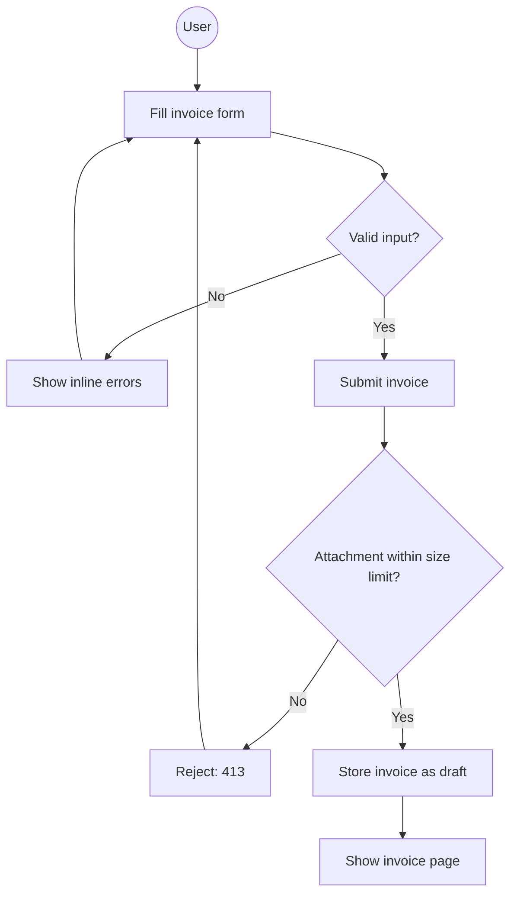
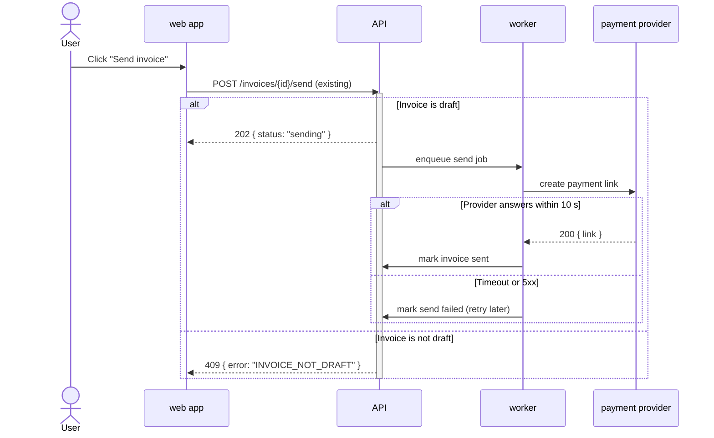
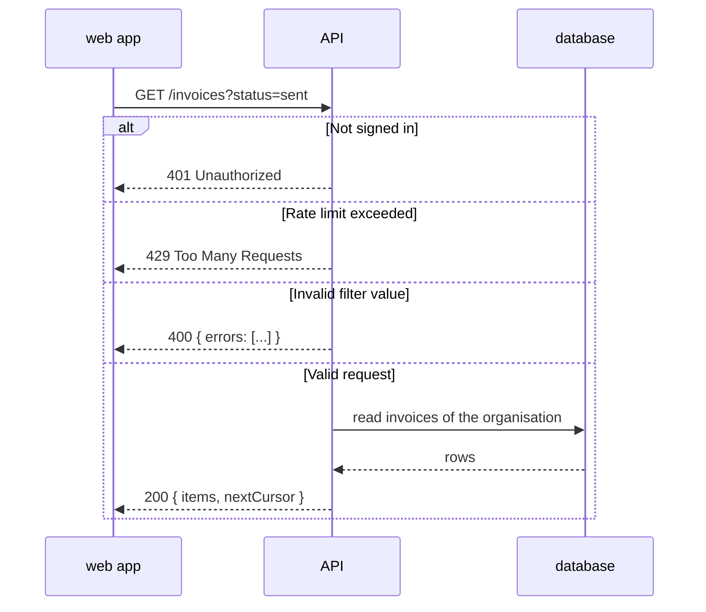
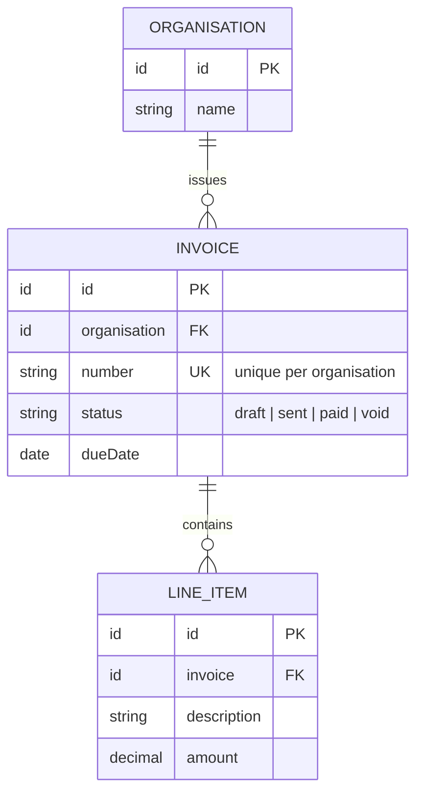
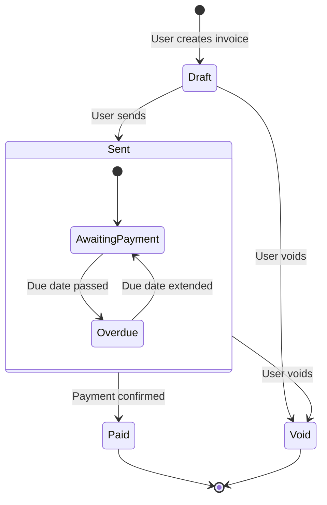
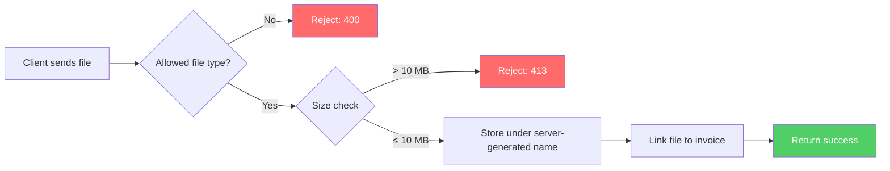
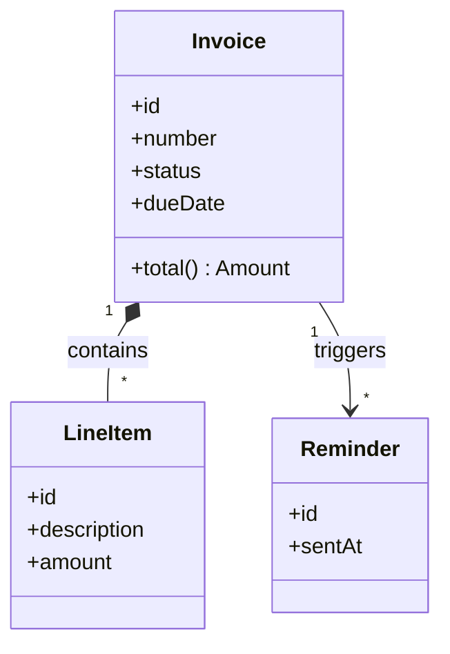
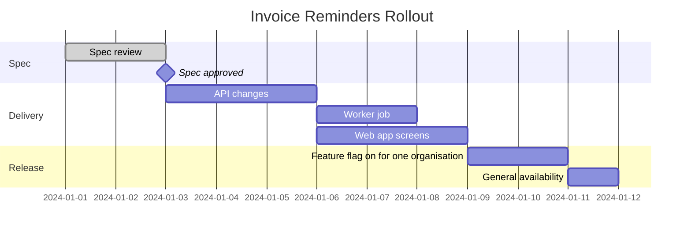
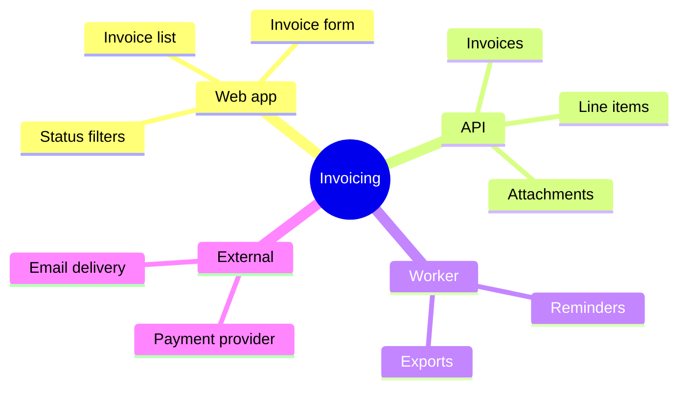

# Mermaid Diagram Examples

Ready-to-use templates on a neutral sample application: an invoicing product
with **the web app** (browser client), **the API** (HTTP backend), **the
worker** (background jobs), a **database** and an external **payment
provider**. In your project, take participant names from the spec's
*System names* and the existing contracts from the code.

In a spec, diagrams show **observable contracts between modules** — calls,
payloads, statuses and failure paths — never internal functions, classes or
libraries.

---

## 1. Flowchart — Invoice Submission Flow

---

## 2. Sequence Diagram — Sending an Invoice (module interactions)

The shape a spec's *Module interactions* section uses: one participant per
system name, existing or new contracts on the arrows, every failure path shown.

---

## 3. Sequence Diagram — Request Pipeline with Failure Paths

---

## 4. ER Diagram — Invoicing Data

---

## 5. State Diagram — Invoice Lifecycle

---

## 6. Flowchart — Upload Validation Pipeline

---

## 7. Class Diagram — Domain Model

---

## 8. Gantt Chart — Rollout Timeline

---

## 9. Mindmap — Feature Breakdown

